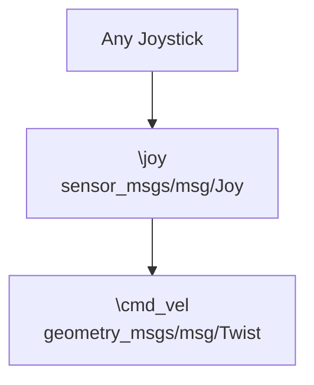

# SCRB-MF-27-06-1-S-ROS2_SWERVE_CONTROLLER
Repository for the development of the drive train ROS2 control controller. This includes the custom swerve drive, Ackermann and differential drive controllers.

# General Vibes

