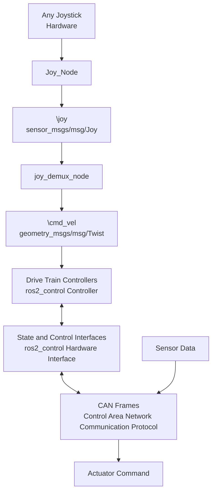

# SCRB-MF-27-06-1-S-ROS2_SWERVE_CONTROLLER
Repository for the development of the drive train ROS2 control controller. This includes the custom swerve drive, Ackermann and differential drive controllers.

# General Vibes

All ready existing controllers to implement:
1. Differential Drive Controller
2. Ackermann Steering Controller

Custom controllers to implement:
1. Double Ackermann Steering Controller
2. Four-Wheel Independent Steering Controller

These controllers are the Drive Train Controllers
